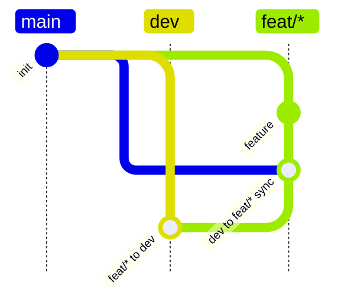

# Git Guard

Git Guard turns a restricted Mermaid `gitGraph` into a local Git `reference-transaction` hook policy.

It is intended for repositories that want branch-flow rules to be written once in a human-readable `contribution.md` file, then enforced locally before invalid branch or tag refs are created.

## Run

### Homebrew (Linux x86_64)

The Homebrew distribution uses the shared `ylang-ylang/tap` tap. The first
installation becomes available after a version-consistent release and its
checked Formula PR have been published; local candidate builds are not releases.

```bash
brew install ylang-ylang/tap/git-guard
git-guard --version
brew update
brew upgrade ylang-ylang/tap/git-guard
brew reinstall ylang-ylang/tap/git-guard
brew uninstall git-guard
```

The Formula installs the published setuptools source distribution into its own
`libexec` virtualenv. Build dependency: `python-setuptools`. Runtime dependencies:
Python 3.13, Git and Bash. It neither modifies system Python nor starts a service.
The first Brew support target is Linux x86_64; other operating systems and CPU
architectures are explicitly refused, not claimed as tested.

Installation, upgrade and removal affect only the package. They never enable
hooks in arbitrary repositories or remove `.git-guard/`, `.branch_logs/`, Git
history, hook state or logs. Activate a chosen repository explicitly with
`git-guard install --repo ... --config ...`. Existing repositories keep their
copied runtime until their configured pre-commit auto-sync or an explicit install
refreshes it; perform checked-in runtime updates on a maintenance branch.

For an existing uv/editable installation, inspect `command -v git-guard` before
switching: `~/.local/bin` may shadow Brew's command. Brew does not remove that
launcher or uninstall another package manager's environment. Retire the old uv
tool explicitly only when you choose to switch; repository data remains intact.

### Running from a checkout

The default workflow does not require installing into Python at all:

```bash
PYTHONPATH=src python -m cli --help
```

This only uses the checkout as source code. It does not write to system Python, user site-packages, or global Python package state.

If you want the `git-guard` command on your `PATH`, install it as an isolated uv tool:

```bash
uv tool install --editable .
git-guard --help
```

`uv tool install` creates a uv-managed tool environment. It is not a system Python install. When switching the global `git-guard` command to a different checkout or worktree, reinstall the editable tool from that checkout:

```bash
uv tool install --editable . --force
```

The command path, such as `~/.local/bin/git-guard`, usually stays the same; the important part is which editable checkout the uv tool points at. The project version may not distinguish local worktrees, so confirm a runtime-sync capable install by checking generated hooks:

```bash
rg git_guard_runtime_sync .git-guard/hooks/common.sh .git-guard/hooks/pre-commit
```

For one-off development checks against the current checkout, prefer `PYTHONPATH=src python -m cli ...` so PATH cannot accidentally use an older uv tool.

Do not run a bare system-level `pip install -e .`. If you choose to use pip manually, activate a project-local virtual environment first:

```bash
python -m venv .venv
. .venv/bin/activate
python -m pip install -e .
```

## Concepts

Each policy config lives under `configs/<name>/`:

```text
configs/<name>/
  contribution.md
  test_case.py
```

`contribution.md` is the source of truth. It contains one supported Mermaid `gitGraph` block.

Wheel and source-distribution installs include all four bundled policy documents
and the complete hook runtime. `setup.py` stages policies from the canonical
`configs/*/contribution.md` files into `git_guard_assets`; no duplicate editable
policy sources are maintained. Installed commands work outside the source tree.
Copied hooks locate Python 3.11 or newer on `PATH` (preferring `python3.13`) rather
than embedding a version-specific Cellar path.

`policy.json` is generated during installation and copied into the target repository under `.git-guard/`. The hook runtime reads this file directly.

Existing installed policy copies require reinstallation to adopt compiler changes: run `git-guard install --repo <repo> --config <config>` with the updated compiler and the desired bundled config name or repository contribution document. In particular, reinstall to expand case-branch origins in `.git-guard/policy.json`; runtime auto-sync alone does not recompile it. Other repositories are not automatically updated.

Reinstalling from an existing contribution document recompiles its graph but preserves its prose, which may still describe only a `main` origin. Choose an updated bundled policy source, or update the repository's own prose, to refresh that explanation too.

`test_case.py` contains config-specific hook behavior tests. Shared test scaffolding lives in `configs/test_base.py`, which only provides generic Git helpers, hook installation, ref snapshots, and rejection assertions. Policy-specific DAG construction and rejection cases belong in each config.

## Supported DSL

Git Guard intentionally supports a small Mermaid subset:

- `branch NAME`: records a branch-from edge from the current checkout.
- `checkout NAME`: changes the current target context.
- `commit id:"..."`: records direct-commit permission for the current non-`main` checkout.
- `merge NAME id:"unique display label"`: records a merge rule into the current checkout.
- `merge NAME id:"unique display label" tag:"..."`: records a merge rule plus a tag policy for the merge result on the current checkout target.

Mermaid `id` values are commit ids and must be unique within the graph. Git Guard derives the policy rule id from the merge source and current checkout target, for example `dev to main`.

For `case/*/*` (`case/<context>/<topic>`), the depicted fork is illustrative: the compiler emits alternative `branch_from` edges from every declared long-lived (non-wildcard) branch, currently `main` and `dev` in all bundled case policies. Creation must use an existing allowed source's current tip; `branch_bases.source_ref` records the matching source, using declaration order if multiple sources share that tip. This expansion changes only case creation, not other branch families or merge permissions: case branches still merge only into `feat/*`, never directly into `main` or `dev`.

A `commit id` containing bare lowercase `branch` as a whitespace-separated word is treated as a compressed branch-history marker. Mermaid renders it with a dashed outline, and Git Guard ignores it when deriving direct-commit permission. For example, `commit id:"dev branch history"` can make a protected integration branch visible in the diagram without allowing direct commits to that branch.

If the same source and target appear once without `tag:"..."` and once with `tag:"..."`, Git Guard treats the tag as optional: the merge is allowed without a tag, but any matching tag is still validated.

For tag policies, Git Guard follows the Mermaid merge direction: `checkout TARGET` followed by `merge SOURCE tag:"..."` means the tag must point at the merge result on `TARGET`. For example, `checkout main` then `merge dev tag:"V#.#"` expects `V#.#` to point at the relevant `main` commit, not the `dev` head.

For `feat/*` and `infra/*`, an immediately adjacent reverse merge before the normal merge declares `sync_merge_required`. `checkout "feat/*"` followed by `merge dev`, then `checkout dev` and `merge "feat/*"`, means feature branches must contain the current `dev` head before they can merge back into `dev`. A branch may continue committing after it absorbs `dev`; it only needs to sync again if `dev` advances beyond the branch's history before the merge back.

Wildcard branch families should be quoted:



Tag patterns currently support:

- `#`: one or more decimal digits.
- `=`: same numeric component as the source branch's base release tag.
- two-component or three-component tags with a `v` or `V` prefix.

Examples:

```text
V#.#
v#.#.0
v=.=.#
```

## Workflow

Protected branches such as `dev` and `main` are integration-only. Do not develop on their checkouts.

- Create a working branch (`feat/*`, `case/*/*`, ...) **before editing anything**, and create it from the **main worktree**. Linked worktrees reject branch creation with `WORKTREE_BRANCH_CREATION_NOT_ALLOWED`; run `git worktree add <path> -b <name>` from the main worktree so each branch gets its own directory.
- Keep protected-branch checkouts for integration merges and read-only verification only.
- An editable-install checkout (uv tool / pip `-e`) is not a workspace: it is only the path the `git-guard` command reads. Develop on a feature branch; if the command should track a different checkout, reinstall the editable tool from there.
- Merge back through the declared flow: sync the target into your branch when the graph requires it, then merge. Delete merged branches from the main worktree.
- If a repository's own installed hook rejects legitimate operations because the checked-out runtime is older than the local Git (for example `HOOK_UNSUPPORTED_PHASE` on newer Git), refresh it with `git-guard install --repo <repo> --config <repo>/.git-guard/contribution.md` from a checkout whose policy allows the operation, and restore the worktree afterwards.

## Install Hook

Install one config into a target repository:

```bash
PYTHONPATH=src python -m cli install \
  --repo /path/to/repo \
  --config dev-infra-feat-release-hotfix-case \
  --scope local
```

`--config` accepts:

- a bundled config name under `configs/`, for example `dev-infra-feat-release-hotfix-case`;
- a config directory containing `contribution.md`;
- a direct path to `contribution.md`.

`--scope` controls where `core.hooksPath` is written:

- `local`: writes to the repository-local config. This is the default and is shared by linked worktrees that use the same common Git directory. It also removes this worktree's `core.hooksPath` override so stale worktree config cannot shadow the repository-local hook path.
- `worktree`: writes to this worktree's config only.
- `global`: writes to the user's global Git config.

The installer writes a repo-relative hook path:

```text
core.hooksPath=.git-guard/hooks
```

During installation, the selected `contribution.md` is parsed automatically and copied into the target repository. Users maintain the policy as Markdown, and the installed runtime policy is written next to the hook.

It copies the packaged runtime hook into the target repo:

```text
<repo>/.git-guard/contribution.md
<repo>/.git-guard/config.json
<repo>/.git-guard/enable.sh
<repo>/.git-guard/hooks/pre-commit
<repo>/.git-guard/hooks/pre-merge-commit
<repo>/.git-guard/hooks/post-commit
<repo>/.git-guard/hooks/pre-push
<repo>/.git-guard/hooks/reference-transaction
<repo>/.git-guard/policy.json
<repo>/.git-guard/runtime/policy_reference_transaction_hook.py
<repo>/.git-guard/runtime/*.py
```

The installed `pre-commit` wrapper can refresh these Git Guard managed files before an ordinary commit is created. If `.git-guard/config.json` keeps `runtime.auto_sync` enabled, the wrapper resolves the current machine's `git-guard` command and runs install again with the repo-local policy source:

```bash
git-guard install --repo <repo> --config <repo>/.git-guard/contribution.md --scope <current-scope>
```

This is a local content check, not a network update check. The repo is current when the files that the current local `git-guard install` would generate already match `.git-guard/`; otherwise install rewrites the changed managed files before the runtime hook runs. When runtime auto-sync rewrites anything, the hook prints a visible `git-guard: runtime auto-sync updated installed assets: ...` message naming the updated files. The repo does not store absolute paths to the Git Guard installation, so two machines with the same protected repo use the `git-guard` available on each machine. Existing installations need one manual reinstall before they have wrappers that can auto-sync themselves.

Runtime auto-sync is skipped when the current worktree is on a policy protected branch such as `main` or `dev`. Protected branch hooks should validate only and must not create worktree changes before an integration merge. Hook entrypoints other than ordinary `pre-commit`, including `reference-transaction`, `pre-merge-commit`, and `pre-push`, also do not run runtime auto-sync because those operations cannot reliably include generated `.git-guard/` files in the Git operation that triggered the hook. Run explicit `git-guard install` on a short-lived branch when checked-in hook/runtime assets need to change, then merge those assets through the normal branch flow.

When `.git-guard/` is tracked by the repository, the installed pre-commit hook requires dirty `.git-guard/` files to be staged. This prevents runtime auto-sync updates on short-lived branches from remaining local-only changes that agents accidentally omit from the commit.

When developing Git Guard itself, a source checkout may disable `runtime.auto_sync` so an older installed `git-guard` command does not rewrite the checked-in runtime with stale code. In that mode, keep `.git-guard/runtime/` updated explicitly with the matching `src/runtime/` changes.

After a protected repository is cloned, users do not need to install this Python package just to enable the checked-in hook. They can run:

```bash
./.git-guard/enable.sh
```

`enable.sh` writes repository-local Git config, so linked worktrees that share the same common Git directory use the same hook path. It also removes this worktree's `core.hooksPath` override so stale worktree config cannot shadow the repository-local hook path. It does not write global Git config:

```text
core.hooksPath=.git-guard/hooks
```

When a Git operation is rejected, the hook prints a `see policy:` hint pointing at `<repo>/.git-guard/contribution.md`. This gives humans and agents a local Markdown file to inspect and repair.

Rejection reasons use a stable `CODE key=value` format, for example:

```text
git-guard: TAG_TARGET_NOT_TARGET_HEAD tag=refs/tags/v1.2.0 target=abc123 target_ref=refs/heads/main
git-guard: see policy: <repo>/.git-guard/contribution.md
git-guard: agent guidance: if you are an agent, read the contribution document and use the configured workflow; do not try to bypass this hook.
```

`.git-guard/config.json` is a human-editable local config file. The installer creates it with defaults and does not overwrite it on later installs:

```json
{
  "auto_push": {
    "enabled": false,
    "include_protected": false,
    "remote": "origin",
    "timeout_seconds": 15
  },
  "branch_logs": {
    "path": ".branch_logs/",
    "force_required": true
  },
  "pre_push": {
    "auto_push_missing_tags": true
  },
  "protected_branches": {
    "enabled": true
  },
  "runtime": {
    "auto_sync": true,
    "require_managed_files_staged": true
  },
  "submodules": {
    "allowed_branches": [
      "main",
      "case/*/*"
    ],
    "main_guard": true
  },
  "worktree": {
    "reject_branch_creation_in_linked_worktree": true
  }
}
```

`branch_logs.path` is a repository-root-relative file or directory path for branch-local development notes. Git cannot track an empty directory, so when the default directory path is required, the installer creates `.branch_logs/.gitkeep` as a neutral placeholder.

If `branch_logs.force_required` is `true`, ordinary commits on policy-managed branches must include a staged branch-log change. For the default directory path, `.branch_logs/.gitkeep` is only a placeholder and does not satisfy the requirement; the staged change must touch another file under `.branch_logs/`. For a file-style `branch_logs.path`, the configured file itself must be staged in the commit. This is the default. If `force_required` is `false`, the path is optional.

The installed `pre-commit` hook rejects untracked or unstaged branch-log files for ordinary commits. This keeps required branch logs from becoming local-only notes that are not actually recorded in the branch history.

If `.git-guard/` is tracked and `runtime.require_managed_files_staged` is enabled, the installed `pre-commit` hook rejects untracked or unstaged `.git-guard/` files with `GIT_GUARD_MANAGED_FILES_NOT_STAGED`. Stage generated hook/runtime updates, or restore them explicitly, before committing.

`protected_branches.enabled` controls merge-source enforcement for protected branches such as `dev` and `main`. The default `true` requires protected branches to move only through policy-declared sources. Setting it to `false` is an emergency escape hatch for direct fast-forward commits on protected branches; deletes and non-fast-forward updates are still rejected.

`branch_logs.path` is target-local during policy-managed merges. For the default directory path, merge commits normalize `.branch_logs/` to `.branch_logs/.gitkeep`, so source branch notes such as `.branch_logs/feat.md` do not propagate into the target branch's final tree.

If a Git merge reports conflicts under `branch_logs.path`, resolve any non-branch-log conflicts and run the merge commit; the installed `pre-commit` hook normalizes `.branch_logs/` to gitkeep-only before commit. The runtime hook still verifies the final merge result before the target ref is updated and rejects with `BRANCH_LOG_TARGET_CHANGED` if extra branch-log files bypass the commit hooks.

For required `merge ... tag:"..."` rules, Git Guard treats the branch merge and tag creation as separate Git ref transactions. The merge may complete first, then the hook records a pending tag requirement for the target merge result. Until the matching tag is created, that target ref is locked with `PENDING_TAG_TARGET_MOVED`. Other refs, including the source branch, are not blocked by that pending release tag.

Optional tag rules do not create pending tag requirements. If a matching tag is created later, the hook still validates its name, version order, target branch history, and immutability.

Policy-managed branches cannot be moved to include another managed branch head unless the Mermaid graph declares that merge direction. This is independent of merge strategy: normal allowed merges may be fast-forward or `--no-ff`. For example, if the graph has `dev to main` but no `main to dev`, `git branch -f dev main` is rejected even when the underlying ref move is a fast-forward.

If a `feat/*` or `infra/*` rule has an immediately adjacent reverse sync merge in the Mermaid graph, the protected target merge is rejected with `SYNC_MERGE_REQUIRED` unless the target's current old head is already an ancestor of the source head. Merge the target branch into the source branch when the target has commits that the source does not contain; if the source already contains the target head, the merge may proceed directly.

Linked worktrees cannot create new local branches while the hook is enabled. A linked worktree is detected when `git rev-parse --git-dir` and `git rev-parse --git-common-dir` resolve to different directories. In that case, `git branch new-name`, `git switch -c new-name`, and other branch-creation ref transactions are rejected with `WORKTREE_BRANCH_CREATION_NOT_ALLOWED`. Create the new branch from the main worktree and give it its own worktree directory instead.

This guard only covers branch creation because it is enforced by the `reference-transaction` hook. Switching a linked worktree to an already-existing branch is not blocked by this hook because that operation does not create a branch ref.

Before any push, the installed `pre-push` hook checks local tags that satisfy the configured release tag rules. If `.git-guard/config.json` keeps `pre_push.auto_push_missing_tags` enabled and a matching local release tag is missing from the target remote, the hook prints a visible `auto-pushing missing release tags` message and pushes that tag first. If the remote already has the same tag name pointing at a different object, the push is rejected with `PUSH_TAG_CONFLICT`.

If `.git-guard/config.json` enables `auto_push.enabled`, the installed `post-commit` hook pushes the current branch tip to `auto_push.remote` after every ordinary or merge commit. This is a publication convenience layer, not a policy mechanism: it is disabled by default, it never blocks or fails the commit, and it prints a visible `auto-pushed <ref> -> <remote>` line on success or an `AUTO_PUSH_FAILED` warning on failure (no retries; the next commit pushes again). Pushes go through the normal `pre-push` hook, so release tag checks and auto-push apply as usual. Branches in `protected_refs` are skipped unless `auto_push.include_protected` is enabled. When the branch upstream is already up to date, the push is skipped without network access. `auto_push.timeout_seconds` bounds the network wait.

If `.git-guard/config.json` keeps the boolean `submodules.main_guard` enabled, every local branch ref update checks all submodule gitlinks in the target commit. `submodules.allowed_branches` lists branch names or branch patterns, such as `["main", "case/*/*"]`, that may contain a submodule gitlink commit. The default is `["main", "case/*/*"]`.

A gitlink that equals a matching local `refs/remotes/origin/<branch>` tip is accepted silently. A gitlink behind a matching remote-tracking branch is accepted with a visible warning. A gitlink only reachable from a matching local `refs/heads/<branch>` is accepted with a visible warning because it is on an allowed branch name but is not known to be on `origin`. A gitlink that is not reachable from any configured branch is rejected with `SUBMODULE_COMMIT_NOT_ALLOWED`. Missing submodule worktrees, missing submodule commits, or missing all configured branch refs are rejected because Git Guard cannot verify the submodule state.

This guard does not fetch remotes. Remote decisions use the submodule's locally known remote-tracking refs. Refresh submodule refs before committing when needed:

```bash
git submodule foreach 'git fetch origin "+refs/heads/*:refs/remotes/origin/*"'
```

Runtime state is stored in the target repo's Git directory:

```text
<repo>/.git/git-guard-state.json
<repo>/.git/git-guard-hook.log
```

`git-guard-hook.log` records every hook trigger: one line per reference-transaction ref update (`phase old new ref`) and one timestamped line per hook invocation (`<iso-time> hook=<name> result=ok|rejected [code=...]`), covering `prepared`/`preparing`, `committed`, `aborted`, `pre-commit`, `pre-merge-commit`, `post-commit`, and `pre-push`. The log lives inside the Git directory, so it is never tracked by Git and needs no `.gitignore` entry; logging failures never affect the hooks.

Because the hook path is repo-relative, a repo generated or installed in Docker can still run from the host without referencing container-only paths.

## Git Version Compatibility

The minimum supported Git version is 2.31 (`git rev-parse --path-format`). The runtime is tested against Git 2.47 and 2.55.

The `reference-transaction` hook payload differs across Git versions, and Git Guard handles both observed behaviors without version-string checks:

- Branch renames never report the new ref to the hook. Git Guard validates rename targets by inspecting the parent `git` process command line, and additionally validates `HEAD` symref updates that point at not-yet-existing branches. A rename to a policy-foreign name is rejected with `BRANCH_NAME_NOT_ALLOWED` whether the renamed branch is checked out or not. If the parent command line is unobservable (non-Linux without `/proc` or `ps`), a rename of a non-current branch cannot be distinguished from a plain deletion and is allowed; renames of the current branch are still caught through the `HEAD` symref update.
- Some Git versions report ref deletions without the old object value. Protected branch deletions and policy tag deletions are nevertheless rejected (`PROTECTED_REF_DELETE`, `TAG_DELETE_NOT_ALLOWED`). Deleting branches outside the policy namespace and tags that match no policy tag rule remains allowed, so pre-policy or accidental refs can be cleaned up.
- Git 2.46 and later emit an additional `preparing` phase before `prepared`; both are validated identically.
- Tag ref transactions report the tag object ID, and during the reference-transaction quarantine the receiving ref does not exist yet. Git Guard peels annotated tag objects to their target commit via `cat-file` before applying tag rules, so both lightweight and annotated release tags are accepted, and creating a matching annotated tag clears the pending tag requirement.

## Release distribution

The canonical GitHub repository is `ylang-ylang/gitguard`. In the maintainer
checkout its remote is **`upstream-github`**, not `origin` (the latter points at
an internal Git server). Actions always address the fixed GitHub repository.

### Versions and maintainer responsibilities

The existing contribution policy remains `feat/* -> dev -> main`, with
`V<major>.<minor>` release tags. Package version `1.18` corresponds exactly to
`V1.18`, not `1.18.0`. Both `pyproject.toml` and the literal `src/cli.py`
`__version__` must agree before a maintainer tags the formal main integration.
The release guard reads these as TOML/AST data; it never imports tagged Python
code to discover its version.

Historical tags through the locally existing `V1.17` carried package version
`0.1.0`. They remain untouched. They are intentionally not republished under a
fabricated version mapping; version-mismatched historical tags fail the new gate.
No compatibility tags are created and no old assets are replaced.

Prepare version changes on a permitted maintenance branch, integrate through the
actual policy, then push the reviewed main integration and its existing tag to
`upstream-github`. CI never chooses a version, edits version files, creates/moves
tags, merges development branches, or updates installed user machines.

### Workflow and immutable artifacts

- `.github/workflows/check.yml`: ordinary branch/PR checks only, including real
  packaged CLI/hooks and a local-candidate Brew install/test.
- `release.yml`: automatic entry is a version-tag push; `workflow_dispatch`
  retries an explicit existing tag. Trusted automation is captured from the
  fixed GitHub dev revision before any tagged source runs. This is the release
  controller, not the software being shipped: tags must still resolve to a full
  commit already in remote main history, not necessarily its current tip.
- The trusted planner has Contents write permission because GitHub hides draft
  releases from callers without push access, but it performs metadata reads only
  and executes no tagged source. A published-by-tag 404 is followed by a complete
  authenticated release listing before declaring absence, so retries find and
  recover the original draft instead of rebuilding or creating duplicates.
- A credential-only job checks for the dedicated tap secret without checking out
  or executing source code. A separate `contents: read` job tests, builds and
  executes the verified commit's sdist/wheel and Formula; it has no tap secret.
- The `contents: write` publisher executes only the captured trusted automation.
  It rechecks tag identity, creates a draft, uploads verified assets, verifies the
  complete set, then publishes. Tag-object/commit drift is a hard failure.
- `release-distribution.yml` uses the same trusted revision and a separate,
  dedicated tap token. It creates/reuses an owned Formula-only PR, verifies its
  complete diff and exact head SHA, requires an explicitly successful
  `tap-checks`, rechecks release identity, and only then merges the PR.

Each release contains `git_guard-<version>.tar.gz` (the Formula source),
`git_guard-<version>-py3-none-any.whl`, `release.json`, and `SHA256SUMS`.
The manifest binds repository/tag/exact source commit and the two independent
asset digests and sizes. The Formula SHA-256 is the **sdist** digest, never the
wheel, manifest, or GitHub source-archive digest.

Retries inspect actual release state. With no Release, an explicit validated
tag can be built. An unfinished draft recovers the original Actions artifact
bound by ID, run/attempt, ZIP digest and manifest digest in its release-note
anchor; it never rebuilds replacement bytes. Original artifacts are retained for
90 days; expired or missing recovery artifacts fail visibly. Published retries
verify original assets without rebuilding, adding, or overwriting them.
Draft assets are fetched through authenticated immutable asset IDs and checked
against the original digests. GitHub's temporary `untagged-*` browser URLs are not
used for download or Formula generation; canonical version-tag URLs are required
after publication and before distribution.

```bash
gh workflow run release.yml --repo ylang-ylang/gitguard --ref dev -f tag=V1.18
# Retry only Brew distribution for an already complete published release:
gh workflow run release-distribution.yml --repo ylang-ylang/gitguard --ref dev -f tag=V1.18
```

Use the tag actually prepared by the maintainer, not a branch name or a free-form
source SHA. A successful rerun of an already shipped Formula is a no-op; a
downgrade, foreign PR, missing/red check, or replaced release asset is refused.

### One-time deployment prerequisites

Integrate automation fixes through maintenance branches into `dev` before
retrying an existing tag. A dev push does not publish software; only a version
tag or explicit existing-tag retry enters the release workflow, and the package
source must remain in main history. Restrict review/write access to both dev
(trusted automation) and main (release source). The GitHub default branch remains
main; local git-guard hooks do not protect GitHub from direct writes.

Configure `HOMEBREW_TAP_TOKEN` **in this source repository**, scoped only to
`ylang-ylang/homebrew-tap`, with Contents and Pull requests read/write, Checks and
Commit statuses read, and GitHub's required Metadata read. Existing Portmap
repository secrets are not shared or exported. Missing credentials fail before
building/publishing; there is no source-token or personal-token fallback.

The one-time shared tap CI extension was merged separately in
[homebrew-tap PR #3](https://github.com/ylang-ylang/homebrew-tap/pull/3), after
`tap-checks` passed. It retains that check name, its Linux runner and all existing
Portmap tests, adds syntax checks for every Formula and Git Guard-only
install/test/reinstall checks, and increases the timeout to 20 minutes.
`Formula/portmap.rb` and other projects were not changed. Routine distribution
PRs must change exactly `Formula/git-guard.rb`; they never modify tap CI.
Editing the workflow for bootstrap required temporary Workflows read/write
permission. Triggering its existing checks for routine Formula PRs does not;
the extra permission can now be removed.

### Local verification without publishing

```bash
python3 -m venv .venv
.venv/bin/python -m pip install build
.venv/bin/python -m unittest discover -s tests -v
.venv/bin/python tools/build_release.py --out-dir .tmp/candidate
VERSION=$(.venv/bin/python -c 'import tomllib; print(tomllib.load(open("pyproject.toml", "rb"))["project"]["version"])')
.venv/bin/python tools/smoke_install.py --python .venv/bin/python \
  --version "$VERSION" --artifact ".tmp/candidate/git_guard-$VERSION.tar.gz"
```

Candidate manifests explicitly contain `candidate: true` and no release
tag/commit/URLs. `tools/release_brew.py render-local` hashes the real candidate
sdist and emits a clearly marked local-only Formula for a temporary validation
tap; it cannot be used by production distribution. Release builds require paired
`--tag`/`--commit`, matching static versions and exact clean source HEAD.

The offline release/tap tests exercise immutable draft recovery, published
no-op retry, tag/version/byte drift, non-main tags, missing credentials, red or
missing checks, concurrent PR edits, and preservation of other tap Formulae.
They do not claim a live GitHub publication; that requires the prerequisites
above.

## Test

Run package-level checks without installation:

```bash
python3 -m compileall -q src configs test_env
```

Run integration tests in Docker:

```bash
mkdir -p .tmp
docker compose run --rm -T policy-hook-tests < /dev/null
docker compose down
```

Closing stdin is required: one test drives the `pre-push` hook directly, and the hook reads ref updates from stdin until EOF. An interactively proxied compose stdin never reaches EOF and the test would block.

The integration test runner creates one isolated test repo per config:

```text
.tmp/dev-feat-release-hotfix-case
.tmp/dev-infra-feat-release-hotfix-case
.tmp/dev-only
.tmp/dev-feat-case
```

Each test repo contains a valid example Git DAG, then a visible start marker before rejection tests:

```text
=========== GIT GUARD REJECTION TESTS START ===========
```

If a Git operation that should be rejected is accepted, the test writes a visible failure marker commit:

```text
!!!!!!!! GIT GUARD EXPECTED REJECTION WAS ACCEPTED !!!!!!!!
```

Successful tests print:

```text
========test finished========
```

This finish marker is stdout only. It is not written into the Git DAG.

## Skill

The bundled Codex skill for writing compatible policy docs lives at:

```text
.codex/skills/git-guard-policy-writer/SKILL.md
```

## License

Git Guard is licensed under the GNU Affero General Public License,
version 3 only. The SPDX license identifier is `AGPL-3.0-only`.

See `LICENSE` for the full license text and `NOTICE` for source
attribution. The public source repository is:

```text
https://github.com/ylang-ylang/gitguard
```

The `LICENSE` text is sourced from the Free Software Foundation:

```text
https://www.gnu.org/licenses/agpl-3.0.txt
```
